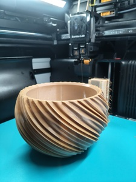
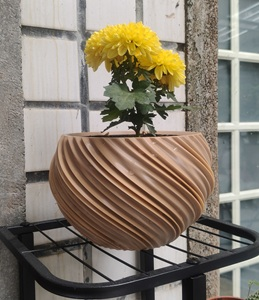
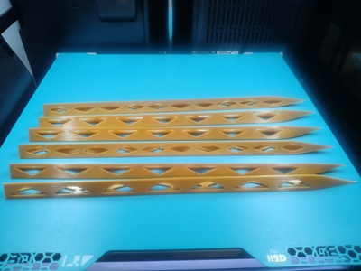
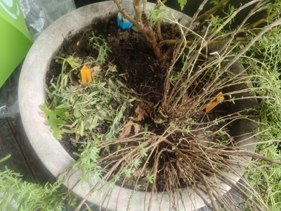
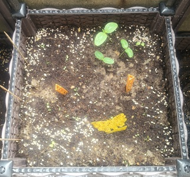
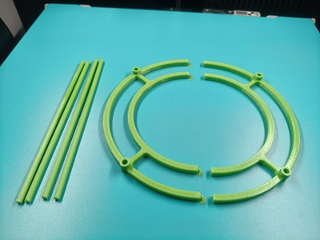
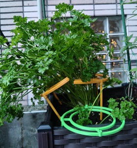

1. 育苗器
2. 花盆
3. 通風管
4. 支架

--- 
## 🪴 育苗器

---
## 🪴 花盆

260512 [自动浇水花盆](https://makerworld.com/zh/models/2511878) 膚色80%+巧克力色20%

--- 
## 🪴 通風管

260522 [花盆通风施肥二合一管：养花防烂根](https://makerworld.com/zh/models/2582033) x6

--- 
## 🪴 支架

260512 [攀爬植物支架](https://makerworld.com/zh/models/1311308)

