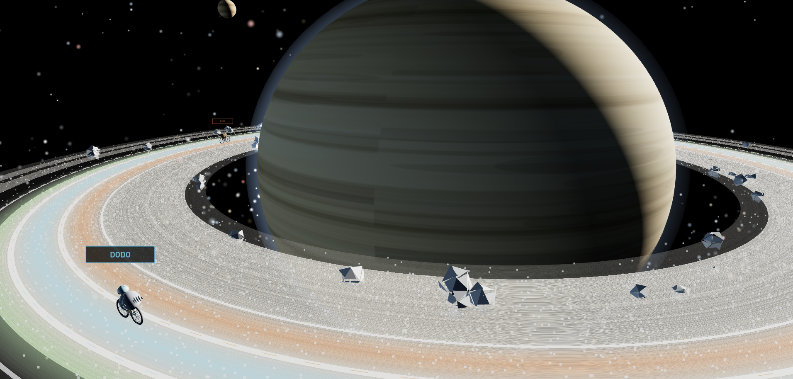

- AI超元域 Googol Gear
- AI超元域 SVG土星自行車動畫測試

## AI超元域 Googol Gear

用 Three.js 寫一個單文件 HTML, 演示 Googol Gear:
一組級聯減速齒輸, 每對傳動比 1:10, 展示10級, 最後1個齒輪旁標注 10^100 秒轉1圈。
旁邊實時顯示每個齒輪的轉速和轉1圈需要多久。
滑鼠左鍵能旋轉視圖, 滑鼠右鍵能移動視圖位置。
視覺要有金屬質感, 震撼大氣。
[260824-googol_gear_Haiku.html](three2026/260824-googol_gear_Haiku.html)
[260824-googol-gear_Opus.html](three2026/260824-googol-gear_Opus.html)
[260824-googol-gear_Opus2.html](three2026/260824-googol-gear_Opus2.html)
[260824-googol-gear_Opus3.html](three2026/260824-googol-gear_Opus3.html)

## AI超元域 土星自行車動畫測試

用 Three.js 畫出動畫, 要求具備真正的動畫效果, 而不是靜止的圖像:
一隻幾維鳥和一隻渡渡鳥還有一隻鵜鶘, 分別騎著自行車在土星的星環上進行比賽, 土星環相當於賽道。
要求土星的比例和這三隻鳥的比例為 20:1。背景為宇宙空間, 可以看到太陽、地球、火星、木星等。
背景營造一種深邃、靜謐的太空環境, 土星環為特寫角度, 以便看清楚三隻鳥的比較細節。
土星環要圍繞著土星, 有種真的在土星外圍比賽的氛圍。
滑鼠左鍵能旋轉視圖, 滑鼠右鍵能移動視圖位置。

土星環影賽道要區分顏色, 三隻鳥要更真實, 色彩更多, 加一個切換到單一車手的車載視角。

鏡頭：開場從全景推進到貼身，之後左鍵旋轉、右鍵平移、滾輪縮放、雙擊復位。貼身模式下鏡頭鎖在集團上並跟著繞行，土星的巨大弧形地平線始終在背後；按「全景」可以退開看整個環繞著土星的樣子。Shift+右鍵放行原生選單。

[260824-saturn-ring-criterium.html](three2026/260824-saturn-ring-criterium.html)
[260824-saturn-ring-criterium2.html](three2026/260824-saturn-ring-criterium2.html)

[Preview](https://htmlpreview.github.io/?https://github.com/AliceYeh/MyAdor/blob/master/Three/three2026/260824-saturn-ring-criterium2.html)

[Opus5 PR 8%+86%]

## 卜卦

用 SVG + 原生 JS 寫一個單文件 HTML「卜卦」(金錢卦), 無外部函式庫(僅 Google Font 楷/宋體)。
視覺古典: 深色漆底, 中央青銅金先天八卦盤(乾上坤下), 太極居中; 卦象解析置於右側宣紙卷軸, 手機版改上下排列。
卜卦前可選問事類別(事業/感情/財運/健康/考試/其他)並輸入所問之事。
點擊後開始卜卦動畫: 八卦盤旋轉發光 → 三枚銅錢擲出翻轉落定, 由下而上逐爻以墨筆繪出;
預設自動連擲六次, 可切換「逐爻手擲」每次點擊擲一爻。老陽○、老陰× 以朱砂標示動爻。
解析內容: 本卦與之卦並列, 卦名、上下卦、卦辭原文、大象傳、白話解說、六類問事建議、六爻爻辭(含用九用六);
依朱熹《易學啟蒙》動爻取象規則高亮應讀之辭。
吉凶分七級(大吉/吉/小吉/平/小凶/凶/大凶), 以卦本身定基準, 動爻爻辭吉凶悔吝微調, 以朱砂印章呈現。
以 cookie 記錄歷史卦象(cookie 不可用時退回 localStorage), 保留最近 20 筆(時間、類別、所問、本卦→之卦、吉凶),
點擊可重看解析, 可清除歷史。
銅錢音效以 Web Audio 合成, 預設關閉可切換; 提供「再卜一卦」並提示「不二占」; 頁尾註明僅供娛樂與自省參考。

[261123-gossip.html](three2026/261123-gossip.html)
[Preview](https://htmlpreview.github.io/?https://github.com/AliceYeh/MyAdor/blob/master/Three/three2026/261123-gossip.html)
