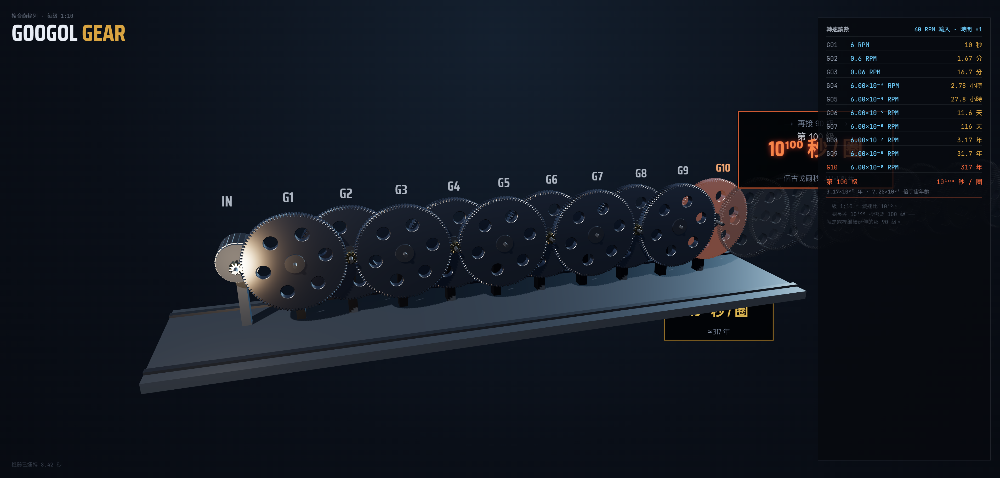
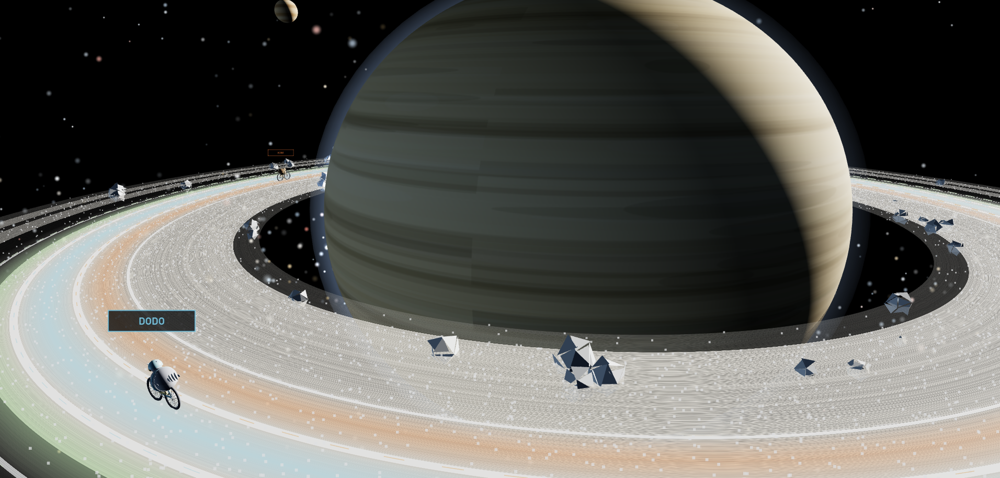

- AI超元域 Googol Gear
- AI超元域 SVG土星自行車動畫測試

## AI超元域 Googol Gear

用 Three.js 寫一個單文件 HTML, 演示 Googol Gear:
一組級聯減速齒輸, 每對傳動比 1:10, 展示10級, 最後1個齒輪旁標注 10^100 秒轉1圈。
旁邊實時顯示每個齒輪的轉速和轉1圈需要多久。
滑鼠左鍵能旋轉視圖, 滑鼠右鍵能移動視圖位置。
視覺要有金屬質感, 震撼大氣。
[260824-googol_gear_Haiku.html](three2026/260824-googol_gear_Haiku.html)
[260824-googol-gear_Opus.html](three2026/260824-googol-gear_Opus.html)
[260824-googol-gear_Opus2.html](three2026/260824-googol-gear_Opus2.html)
[260824-googol-gear_Opus3.html](three2026/260824-googol-gear_Opus3.html)

## AI超元域 土星自行車動畫測試

用 Three.js 畫出動畫, 要求具備真正的動畫效果, 而不是靜止的圖像:
一隻幾維鳥和一隻渡渡鳥還有一隻鵜鶘, 分別騎著自行車在土星的星環上進行比賽, 土星環相當於賽道。
要求土星的比例和這三隻鳥的比例為 20:1。背景為宇宙空間, 可以看到太陽、地球、火星、木星等。
背景營造一種深邃、靜謐的太空環境, 土星環為特寫角度, 以便看清楚三隻鳥的比較細節。
土星環要圍繞著土星, 有種真的在土星外圍比賽的氛圍。
滑鼠左鍵能旋轉視圖, 滑鼠右鍵能移動視圖位置。

土星環影賽道要區分顏色, 三隻鳥要更真實, 色彩更多, 加一個切換到單一車手的車載視角。

鏡頭：開場從全景推進到貼身，之後左鍵旋轉、右鍵平移、滾輪縮放、雙擊復位。貼身模式下鏡頭鎖在集團上並跟著繞行，土星的巨大弧形地平線始終在背後；按「全景」可以退開看整個環繞著土星的樣子。Shift+右鍵放行原生選單。

[260824-saturn-ring-criterium.html](three2026/260824-saturn-ring-criterium.html)
[260824-saturn-ring-criterium2.html](three2026/260824-saturn-ring-criterium2.html)

[Preview](https://htmlpreview.github.io/?https://github.com/AliceYeh/MyAdor/blob/master/Three/three2026/260824-saturn-ring-criterium2.html)

[Opus5 PR 8%+86%]
